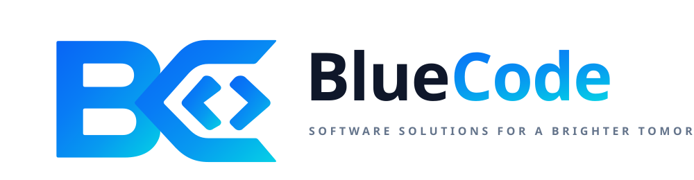
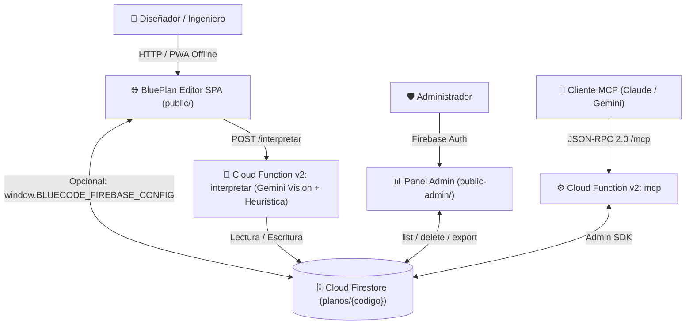

# BluePlan — Editor Vectorial de Planos de Instalación de Red

<div align="center">



**Suite web vectorial SVG para el diseño, acotado, ruteo automático y exportación de planos técnicos de fibra óptica, cableado estructurado e infraestructura eléctrica, desarrollada por [BlueCode](https://bluecode-landing.pages.dev/).**

[](https://bluecode-landing.pages.dev/)
[]()
[]()

</div>

---

## 🌟 Descripción General

**BluePlan** es un editor técnico de planos de instalación en navegador (SPA autocontenida + PWA offline) orientado a proyectos de telecomunicaciones y redes de fibra óptica. Permite dibujar cuartos arquitectónicos, posicionar simbología técnica estándar (**RETIE** / **IEEE** / **TIA-568**), trazar tendidos con **ruteo ortogonal A\*** por carriles perimetrales y exportar entregables listos para obra en **PNG (300 DPI)**, **SVG**, **PDF (A4 apaisado)**, **JSON** y **Excel (`.xlsx`)** con membrete técnico **BlueCode (`BC-PL-001`)**.

---

## 🏗️ Arquitectura del Sistema



---

## 📁 Estructura del Proyecto

```text
blueplan-bluecode/
├── public/                                  # Aplicación principal del editor (Hosting target: main)
│   ├── index.html                           # SPA SVG CAD autocontenida con marca y membrete BlueCode
│   ├── manifest.json                        # Manifiesto PWA con iconos oficiales BlueCode
│   └── assets/
│       ├── logo-bluecode-horizontal-light.svg  # Logotipo horizontal vectorial oficial BlueCode
│       ├── logo-bluecode-simbolo.svg           # Isotipo BC<> oficial (favicon y toolbar)
│       ├── logo-bluecode-completo-light.svg    # Logotipo vertical completo BlueCode
│       ├── logo-bluecode-app-icon.svg          # Ícono de aplicación vectorial
│       ├── icon-192.png / icon-512.png         # Iconos PWA rasterizados BlueCode
│       ├── nf-logo.png / xls-logo.png          # Logotipo BlueCode para exportación Excel
│       └── nf-*.png / xls-*.png                # Láminas de simbología eléctrica RETIE y telecomunicaciones
├── public-admin/                            # Panel de administración (Hosting target: admin)
│   └── index.html                           # Dashboard multi-tema para gestión de salas
├── functions/                               # Backend opcional en Cloud Functions v2 (Node.js 22)
│   ├── index.js                             # Servidor remoto MCP (/mcp) e intérprete IA (/interpretar)
│   ├── package.json                         # Dependencias MCP SDK, Firebase Admin y Zod
│   └── lib/
│       ├── acomodar.js                      # Heurística geométrica de muros, esquinas y clusters
│       ├── autolink.js                      # Auto-conexión técnica (SPT→TDG, AP→RACK, etc.)
│       ├── catalog.js                       # Catálogo de símbolos y tipos de tendido
│       ├── firestore.js                     # Operaciones transaccionales de salas (membrete BC-PL-001)
│       ├── geometria.js                     # Cálculo de cajas, colisiones y anclajes
│       ├── interpretar.js                   # Análisis de croquis multi-pasada con Gemini Vision
│       ├── reglas.js                        # Reglas determinísticas post-inferencia
│       └── revisar.js                       # Revisión visual comparativa automatizada
├── SIMBOLOGIA RETIE/                        # Biblioteca base de símbolos vectoriales RETIE
├── firebase.json                            # Configuración de Firebase Hosting y rewrites
├── .firebaserc                              # Targets desacoplados para proyecto Firebase BlueCode
├── firestore.rules                          # Reglas de seguridad Firestore basadas en roles admin
├── manifest.json                            # Manifiesto raíz de metadatos PWA
├── MCP.md                                   # Guía de conexión para clientes Model Context Protocol
└── README.md                                # Documentación técnica principal
```

---

## ⚡ Guía de Inicio Rápido

### Prerrequisitos
- **Python ≥ 3.11** (o cualquier servidor HTTP estático) para uso local del editor
- **Node.js ≥ 22** y **Firebase CLI** (opcional, únicamente para backend `/interpretar` y `/mcp`)

### Ejecución Local (100% funcional sin backend)
```bash
# 1. Clonar el repositorio
git clone https://github.com/allanperezro123-beep/blueplan-bluecode.git
cd blueplan-bluecode

# 2. Levantar servidor local en un puerto libre (ej. 8081)
python -m http.server 8081 --bind 127.0.0.1 --directory public

# 3. Abrir en el navegador
# http://localhost:8081
```

### Configuración Opcional de Nube (Firebase + IA + MCP)
1. Crea un proyecto propio en Firebase y actualiza `.firebaserc` y `window.BLUECODE_FIREBASE_CONFIG` en `public/index.html` y `public-admin/index.html`.
2. Instala las dependencias de backend y configura el secreto de Gemini:
```bash
cd functions
npm install
firebase functions:secrets:set GEMINI_API_KEY
firebase deploy
```

---

## 🎨 Identidad Visual & Personalización BlueCode

- **Logotipos vectoriales oficiales:** Isotipo animado `BC<>` en la barra superior, favicon vectorial y logotipo horizontal SVG de BlueCode incrustado en el membrete técnico (**`BC-PL-001`**) y en la exportación PNG/PDF/Excel.
- **Formato Técnico Neutral (`BC-PL-001`):** Se eliminaron las plantillas, membretes, códigos de contrato y bases de beneficiarios heredadas de terceros, adoptando campos genéricos reutilizables para cualquier proyecto de ingeniería:
  - `DEPARTAMENTO / REGIÓN`
  - `CIUDAD / MUNICIPIO`
  - `PROYECTO / SEDE`
  - `CÓDIGO DE SITIO`
  - `CLIENTE / RESPONSABLE` (por defecto `BlueCode`)

---

## 🛡️ Estándares de Ingeniería & Normas ISO

Este proyecto sigue las directrices internacionales de calidad, seguridad, documentación y gobernanza de IA:

- **ISO/IEC 25010 (Calidad de Producto Software):** Interfaz CAD SVG modular con operación offline garantizada, exportación fiel en múltiples formatos, deshacer/rehacer robusto y diseño responsive adaptado a escritorio y móvil.
- **ISO/IEC 27001 (Seguridad de la Información):** Cero credenciales o secretos en el repositorio (`.gitignore` estricto y configuración Firebase desacoplada), sanitización de atributos SVG contra XSS y control administrativo en `firestore.rules` basado en claims (`request.auth.token.admin == true`).
- **ISO/IEC 42001 (Gobernanza de Sistemas de IA):** Pipeline `/interpretar` con validación determinística posterior al modelo (`reglas.js`, `acomodar.js`), límites de seguridad en correcciones (`revisar.js`) y validación de esquemas con Zod en todas las herramientas del servidor MCP.
- **ISO/IEC/IEEE 26514 (Documentación Técnica):** Documentación estructurada con diagramas Mermaid, árbol completo de archivos y pasos reproducibles de instalación y despliegue.
